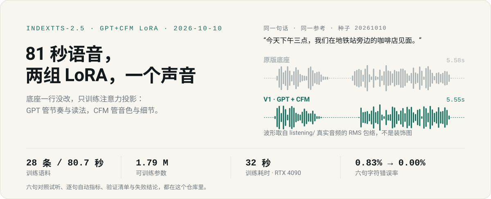
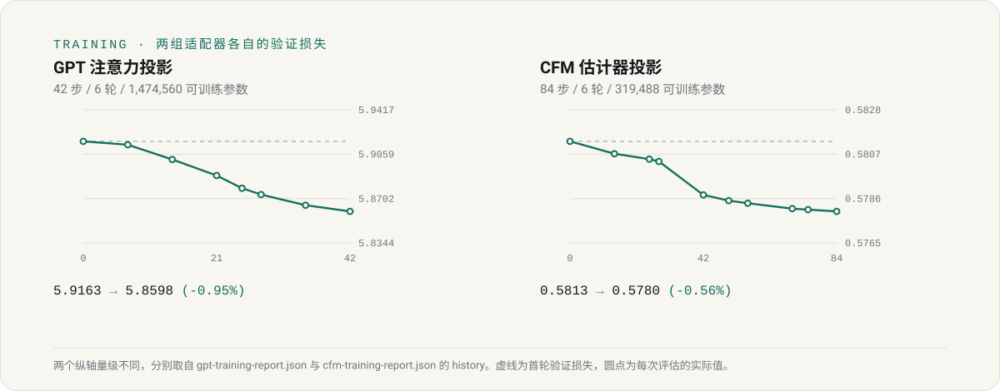

# IndexTTS-2.5 单说话人联合 LoRA · V1

底座参数一行没改，只给 GPT 和 CFM 各挂一组注意力投影适配器：**GPT 管节奏和读法，CFM 管音色和声学细节**。训练用 28 条、80.7 秒的语音，训练和试听都发生在 2026 年 10 月 10 日。

下面先讲清楚怎么训的，再放同一句话的原版与训练后给你听，最后是逐句指标、验证清单和没做成的地方。

## 怎么训练的

**目标**：不是造一个通用模型，而是让 IndexTTS-2.5 认熟一个特定说话人的音色和读法。所以本轮只做一件事——在不破坏底座的前提下，把这点数据学进去。

### 1. 语料：从源音频里筛出 28 条

原始素材是一段公开视频的配音（来源与授权见「边界」）。切分、打分、筛两轮：

- 第一轮 412 条候选，阈值定得太严，只剩 6 条，不够用；
- 第二轮放宽阈值重筛：302 条候选过自动筛选留下 37 条，再去掉质量最差的一批；
- 最终 **28 条训练（80.7 秒）+ 7 条验证（21.7 秒）**，文本和时间都与训练集错开。

筛选依据是自动指标：时长区间、语音活跃比、浊音比、音乐占比，加上 Whisper 与第二套识别器对同一段的一致性。**全程没有人工听审**，这是本轮的硬伤之一，所以每句都要靠试听复核。

### 2. 挂什么：两组 LoRA，只动注意力投影

不动底座权重，不换 codec，不替换说话人嵌入。两组适配器分别挂在：

- **GPT 侧**：Transformer 各层的注意力输出投影（漂移最大的层是 `gpt.h.0.attn.c_proj`）
- **CFM 侧**：estimator Transformer 各层的注意力输出投影（漂移最大的层是 `estimator.transformer.layers.0.attention.wo`）

### 3. 超参

两侧一致：rank 8、alpha 16、dropout 0.05、学习率 5e-5（warmup + 衰减到 5e-6）、weight decay 0.02。GPT batch 2、CFM batch 1，两侧梯度累积都是 2。6 轮，没有提前停止。

| | GPT | CFM |
| --- | ---: | ---: |
| 步数 / 轮数 | 42 / 6 | 84 / 6 |
| 可训练参数 | 1,474,560 | 319,488 |
| 底座参数 | 812,289,460 | 98,187,344 |
| 精度 | 底座 bf16 · 适配器 fp32 · 开梯度检查点 | 全程 fp32（关检查点换速度） |
| 显存峰值 | 1.94 GB | 1.09 GB |
| 训练循环耗时 | 13.9 秒 | 18.1 秒 |
| 首轮 → 最佳验证损失 | 5.9163 → 5.8598（-0.95%） | 0.5813 → 0.5780（-0.56%） |
| 底座漂移（全局相对） | 0.0007 | 0.0050 |

一张 RTX 4090 24GB 跑完。上面的耗时只算训练循环，不含转写、筛选、加载底座和评估。

### 4. 这轮最大的缺陷：回放比例 = 0

训练全程只看目标说话人的数据，没有掺任何通用语音。这是灾难性遗忘最典型的成因：模型会逐步丢掉通用发音能力。漂移只有 0.0007 / 0.0050，小到"几乎没动到底座"——既是保守配置的结果，也是数据太少的证据。

所以这版**只说明这点数据上发生了什么，不能当通用声音模型用**。下一轮该做的是：语料从 28 条做起，replay 提到 0.5 以上，再加人工听审。

## 听一段：原版 vs 训练后

> 今天下午三点，我们在地铁站旁边的咖啡店见面。

同一条 6.62 秒参考、同一种子 `20261010`、同一套采样参数，只换了适配器。两段都是原始合成，没有降噪、拉伸或修补——差别来自权重。

| | 时长 | 播放 |
| --- | ---: | --- |
| 原版底座 | 5.58 秒 | [▶ 在浏览器里播放](https://feiwell.github.io/indextts25-mirror-lora/play.html#baseline) · [wav 文件](listening/baseline/01.wav) |
| 训练后 · GPT + CFM | 5.55 秒 | [▶ 在浏览器里播放](https://feiwell.github.io/indextts25-mirror-lora/play.html#v1) · [wav 文件](listening/finetuned-best/01.wav) |

GitHub 的 README 不允许内嵌播放器，所以播放页放在 GitHub Pages 上，点开即可播（[play.html](https://feiwell.github.io/indextts25-mirror-lora/play.html)，两段并排）。

想继续听：六句短句 × 五路模型（原版 / V1 / 仅 GPT / 仅 CFM / 另一组检查点）在 [listening.html](listening.html)，756 字长文的对照在 [longtext-20261010/listening.html](longtext-20261010/listening.html)。

## 数字

| 模型 | 字符错误率 | 音色相似度（训练参考） | 音色相似度（验证语音） |
| --- | ---: | ---: | ---: |
| 原版底座 | 0.83% | 0.894 | 0.674 |
| V1 · GPT + CFM | **0.00%** | 0.902 | 0.695 |
| 仅 GPT | 0.00% | 0.892 | 0.675 |
| 仅 CFM | 0.83% | 0.901 | 0.692 |
| 另一组检查点 | 0.00% | 0.907 | 0.698 |

六句共 121 个归一化字符；字符错误率用 Whisper turbo（温度 0、beam 5）转写后计算，相似度是 CAMPPlus 余弦——**只说明在这个嵌入空间里更接近，不等于听感更好**。

底座那 0.83% 全部来自第 6 句的一个字：「顺路」被念成「深路」。V1 和仅 GPT 都念对了。这是本轮唯一能指到具体位置的变化，所以我把它写在这里，而不是包装成"准确率提升"。六句样本太小，0.83% → 0.00% 只是一次字符编辑的差别。

逐句时长、音量、峰值、转写原文在 [evaluation-metrics.json](evaluation-metrics.json)。

## 验证了什么

下面这些都能复算，不靠耳朵：

- 226 个文件 SHA256 核对通过；
- 关掉两组适配器，输出与原版底座**逐采样点相同**；
- 打开任意一组，六句全部与原版不同；
- 六句测试文本确实不在训练集与验证集里；
- 交付目录里的权重被独立重新加载，推理结果与交付音频逐采样一致；
- 另一组检查点的权重哈希不同，不是同一份权重存了两遍；
- 完整长音频的 PCM 逐采样等于各分段音频加 200ms 静音的拼接（长文、稳健性两轮同样核对）。

明细见 [local-verification.json](local-verification.json) 与各子目录下的 `local-verification.json`。

## 后面又做了什么

这版权重后来没有继续训练，只拿它做压测。四轮都留了原始音频、转写和脚本，也都没有人工听审：

| 子实验 | 做了什么 | 结论（都不是"提升"） |
| --- | --- | --- |
| [longtext-20261010](longtext-20261010/README.md) | 756 字故事，120 / 60 token 分段 | 逐段字符错误率 3.41% / 2.37%，原版 2.67%；整段那次 18.81% 是 Whisper 尾部幻觉（多出 112 次插入，如"请不吝点赞"），关掉跨窗口上下文后降为 3.11% |
| [long-paced-v1-20261010](long-paced-v1-20261010/README.md) | 1518 字完整故事，10 段 / 20 个合成段 | 336.88 秒，原版 301.50 秒；逐段字符错误率 2.28% vs 1.62%；31 次替换、0 删除、0 插入，6 个疑点用 SenseVoice 二次复核 |
| [robustness-v1-20261010](robustness-v1-20261010/README.md) | 五类新文本：技术说明、情绪对白、长故事、数字播报、多音字 | 长文两套识别器方向相反（Whisper 1.62% vs 1.69%，SenseVoice 1.69% vs 1.32%）；数字播报 SenseVoice 转写与目标文本完全一致 |
| [pace-v1-tail-selected-20261010](pace-v1-tail-selected-20261010/report.md) | 用原生 `duration_factor` 调尾段时长 | 0.948 → 尾段 7.337 秒，是用户听过后认可的版本；这是单段、单种子的对照，不是全局语速预设 |

合起来一句话：短句上有一点能指认的变化，长文上没有稳定优势，所有"更好"都还缺人工听审。

## 权重与底座

- GPT 适配器：[repo/training_runs/gpt-first-round/adapter](repo/training_runs/gpt-first-round/adapter)
- CFM 适配器：[repo/training_runs/cfm-first-round/adapter](repo/training_runs/cfm-first-round/adapter)
- 每个方向另有 4 个检查点在 `checkpoints/` 下；对比时用的是权重哈希不同的那一组。

这些文件只是 LoRA，**不能替换 IndexTTS-2.5 底座，也不要覆盖 `gpt.pth` / `s2mel.pth`**。底座需要自行准备：IndexTTS-2.5-Pro（源码提交 `d3439bccb061944abf745844274aa0c2edfa35a3`）、w2v-bert-2.0、BigVGAN、CAMPPlus。已生成的音频可以直接听，不需要底座。

参考音频是 `utt_00263`，取自源音频 1069.30–1075.92 秒，时长 6.62 秒。

## 边界

- 声音来自 bilibili 视频 [BV1FA4m1G7fY](https://www.bilibili.com/video/BV1FA4m1G7fY)（UP：美御Mirror）。**我没有取得任何使用或训练授权**——这是私人实验记录，不发布模型，也不提供可直接使用的角色声音。
- 单一说话人、单一参考、28 条语料、一个版本，不能外推到其他音色。
- 全部指标都是自动评价：ASR 的同音字、专名、代词差异不能直接当成发音错误；数字播报的分数还受阿拉伯数字写法影响。
- 原始录音、训练切片和参考片段没有公开，仓库里只有合成结果和过程记录。

## 文件在哪

| 路径 | 内容 |
| --- | --- |
| [play.html](play.html) | 一句话的原版 / 训练后对照播放页（GitHub Pages 上可直接播） |
| [listening.html](listening.html) | 六句 × 五模型的完整对照播放器，自包含单文件 |
| `listening/` | 各组 wav：`baseline` / `finetuned-best` / `gpt-only` / `cfm-only` / `alternate-checkpoints` / `reproduced` |
| `repo/training_runs/` | 两组 LoRA、检查点、训练日志、`run.json` |
| [evaluation-metrics.json](evaluation-metrics.json) | 逐句时长、音量、转写、字符错误率、音色相似度 |
| [gpt-training-report.json](gpt-training-report.json) · [cfm-training-report.json](cfm-training-report.json) | 逐 step 损失、漂移检查、显存、自动告警 |
| [dataset-final-summary.json](dataset-final-summary.json) · `curation-*.json` | 筛选过程：候选数、阈值、拒绝原因 |
| [provenance.json](provenance.json) | 源音频信息、底座权重哈希、上游源码提交 |
| `assets/readme/` | 本页用的两张 SVG，以及从真实音频与训练报告重新生成它们的 [build_assets.py](assets/readme/build_assets.py) |
